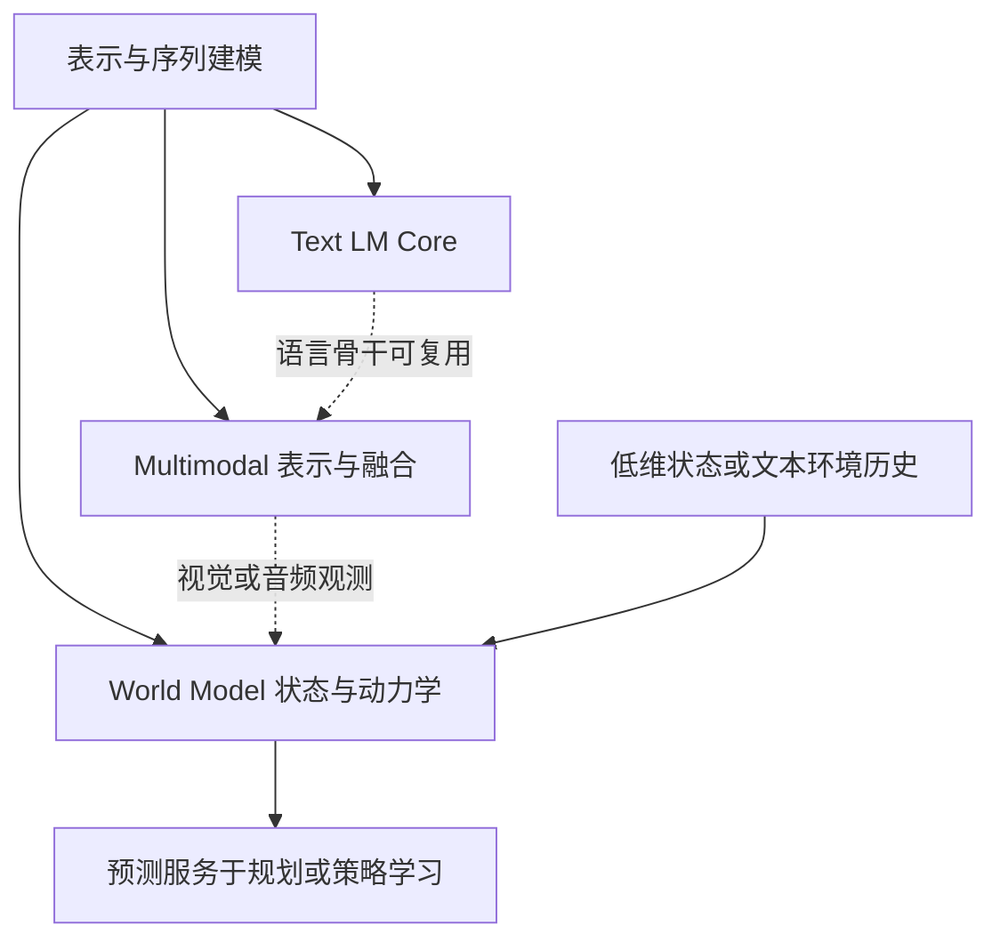

Architecture 整理模型由什么组成、信息如何流动，以及结构选择如何影响训练、推理和应用。知识主线包括文本语言模型、多模态模型，以及用于环境预测的世界模型；三者共享部分表示与序列建模技术，但各有不同的问题边界。

## 这条主线回答什么问题

架构学习围绕四个问题展开：

1. 模型如何表示输入，并在层之间变换信息？
2. 不同 token、模态和时间位置如何交互？
3. 模型是否只预测序列延续，还是进一步表示 state、action 和 future？
4. 结构选择如何改变训练目标、推理成本和可执行能力？

## Recommended Path

1. [[architecture/transformer/transformer|Transformer]]：先理解 block、residual、normalization、FFN 和 decoder-only 结构。
2. [[architecture/attention/attention|Attention]]：再理解 self-attention、MHA、MQA/GQA/MLA 和长上下文 attention 变体。
3. [[architecture/positional-encoding/positional-encoding|Positional Encoding]]：理解 RoPE、ALiBi、YaRN 等位置机制如何影响 attention。
4. [[architecture/sparse-and-efficient/moe|Mixture of Experts]]：理解 dense FFN 到 sparse expert FFN 的容量/计算取舍。
5. [[architecture/model-families/|Model Families]]：把 GPT、LLaMA、Qwen、DeepSeek 等看作基础机制的组合案例。
6. [[fundamentals/representation-learning/|Representation Learning]]：理解不同模态如何形成可对齐、可预测的内部表示。
7. [[architecture/multimodal/|Multimodal]]：理解图像、音频、视频如何进入语言模型并形成 observation representation。
8. [[fundamentals/dynamical-systems/|Dynamical Systems]] 与 [[fundamentals/control-and-planning/|Control and Planning]]：补上 state、action、transition、reward 和 planning 的环境建模语言。
9. [[architecture/world-models/|World Models]]：理解模型如何从 observation 走向 latent state、dynamics 和 action-conditioned future prediction。

前五步构成文本语言模型的基础路线。第六步以后可以分支学习：多模态方向关注表示、对齐和融合，世界模型方向关注状态、动力学和决策。研究低维状态或文本工具环境时，可以直接进入环境建模基础；研究视觉机器人或视频环境时，再补充相应的多模态表示。完整的 World Model 学习与复习导航集中在 [[architecture/world-models/|World Models]]。

## Core Modules

- [[architecture/transformer/|Transformer]] — 标准 Transformer 结构、decoder-only、FFN、归一化和残差。
- [[architecture/attention/|Attention]] — Self-Attention、MHA、MQA、GQA、滑动窗口注意力。
- [[architecture/positional-encoding/|Positional Encoding]] — 绝对位置、正弦位置、RoPE、ALiBi、YaRN。

## Model and Architecture Families

- [[architecture/model-families/|Model Families]] — GPT、LLaMA、Qwen、DeepSeek、Mistral、Gemma 等模型家族。
- [[architecture/sparse-and-efficient/|Sparse and Efficient Architectures]] — MoE、Mamba、SSM、Linear Attention 等高效路线。
- [[architecture/multimodal/|Multimodal]] — 模态 encoder、alignment、projector、fusion，以及视觉、音频、视频与文本的联合建模。
- [[architecture/world-models/|World Models]] — observation、state、action、dynamics、reward、rollout 和未来状态预测。

## Text LLM、Multimodal LLM 与 World Model

Text LLM 指以文本为主要输入输出的大语言模型（Large Language Model，LLM）；Multimodal LLM 扩展其能够处理的输入、输出或交互模态；World Model 则描述模型对环境状态及其演化的建模功能。前两者主要按模态和模型体系命名，后者主要按功能命名，因此可以交叉。

| 概念           | 主要回答                             | 典型输入输出                                                                 | 关键边界                                 |
| -------------- | ------------------------------------ | ---------------------------------------------------------------------------- | ---------------------------------------- |
| Text LLM       | 如何根据文本上下文预测后续序列       | text → text                                                                  | 不要求环境状态、动作和反馈               |
| Multimodal LLM | 如何编码、对齐和推理不同模态         | multimodal input → text, action or multimodal output                         | “多模态”不默认表示多模态输入和输出都支持 |
| World Model    | 环境状态如何演化，行动会产生什么后果 | observation/history + optional action → future state / observation / outcome | 控制用途还需验证动作响应和决策价值       |

两条轴可以独立考察：

```text
输入输出模态：  text | image | audio | video | sensor | combinations
环境建模功能：  state estimation | temporal prediction | action-conditioned dynamics
```

例如，图像问答模型可以是只支持多模态输入、文本输出的 Multimodal LLM；文生图或语音对话系统则可能支持多模态输出；只根据位置和速度预测运动的模型可以是 World Model；视觉机器人系统可以把两者组合起来。CLIP 一类图文表示模型属于广义 Multimodal Model，但本身不是生成式 LLM。文本 LLM 也可能形成环境表示，是否足以预测真实行动后果，需要另外验证。

### 输入、输出与交互类型

“Multimodal LLM”不是一个足以描述完整能力的标签。阅读论文、模型卡或产品文档时，应分别记录：

```text
Input modalities:  text / image / audio / video / sensor
Output modalities: text / image / audio / video / action
Interaction type:  understanding / generation / transformation / any-to-any
```

常见组合包括：

| 类型                          | 输入                                 | 输出               | 主要任务                             |
| ----------------------------- | ------------------------------------ | ------------------ | ------------------------------------ |
| Multimodal Understanding      | 图像、音频、视频、文本中的一种或多种 | 主要是文本         | 图像问答、OCR、视频问答、语音理解    |
| Multimodal Generation         | 文本或多模态条件                     | 图像、音频、视频等 | 文生图、图像编辑、文生音频、视频生成 |
| Any-to-Any / Omni             | 多种模态                             | 多种模态           | 实时语音、视觉、文本和音频联合交互   |
| Vision-Language-Action（VLA） | 视觉、语言和环境状态                 | 动作或控制指令     | 机器人、GUI 和具身 Agent 控制        |

多模态输入和多模态输出是两个独立能力。一个模型可以看图但只输出文字，也可以生成图像但不接受图像输入；系统支持多模态输入输出，也不代表由同一个参数化模型原生完成，中间可能串联 encoder、LLM、diffusion decoder、语音模块或动作控制器。

## 从共同基础到两条分支



图中连线表示可组合的依赖关系。多模态模型也可以进行时间推理；世界模型也可以采用语言、循环网络或其他结构。用于控制的世界模型尤其关心 action conditioning（动作条件化）、候选行动后果的比较，以及预测与真实环境反馈的一致性。生成逼真的视频和直接输出动作，都不足以单独证明这些能力。

## 三条架构回顾入口

- **Text LM Core**：[[architecture/transformer/|Transformer]] → [[architecture/attention/|Attention]] → [[architecture/positional-encoding/|Positional Encoding]] → [[architecture/model-families/|Model Families]]。
- **Multimodal Observation**：[[fundamentals/representation-learning/|Representation Learning]] → [[architecture/multimodal/|Multimodal]] → [[architecture/multimodal/vision-language-model|Vision-Language Model]] → [[architecture/multimodal/multimodal-projector|Multimodal Projector]]。
- **World Model and Decision**：[[fundamentals/dynamical-systems/|Dynamical Systems]] → [[fundamentals/control-and-planning/|Control and Planning]] → [[architecture/world-models/|World Models]] → [[application/agents/planning|Planning]]。

本页负责全局定位；[[architecture/multimodal/|Multimodal]] 负责模态表示与模型接口；[[architecture/world-models/|World Models]] 负责跨基础、架构、训练、推理和应用的系统学习路线。具体机制的推导、论文证据和实验记录由相应专题页承接。
