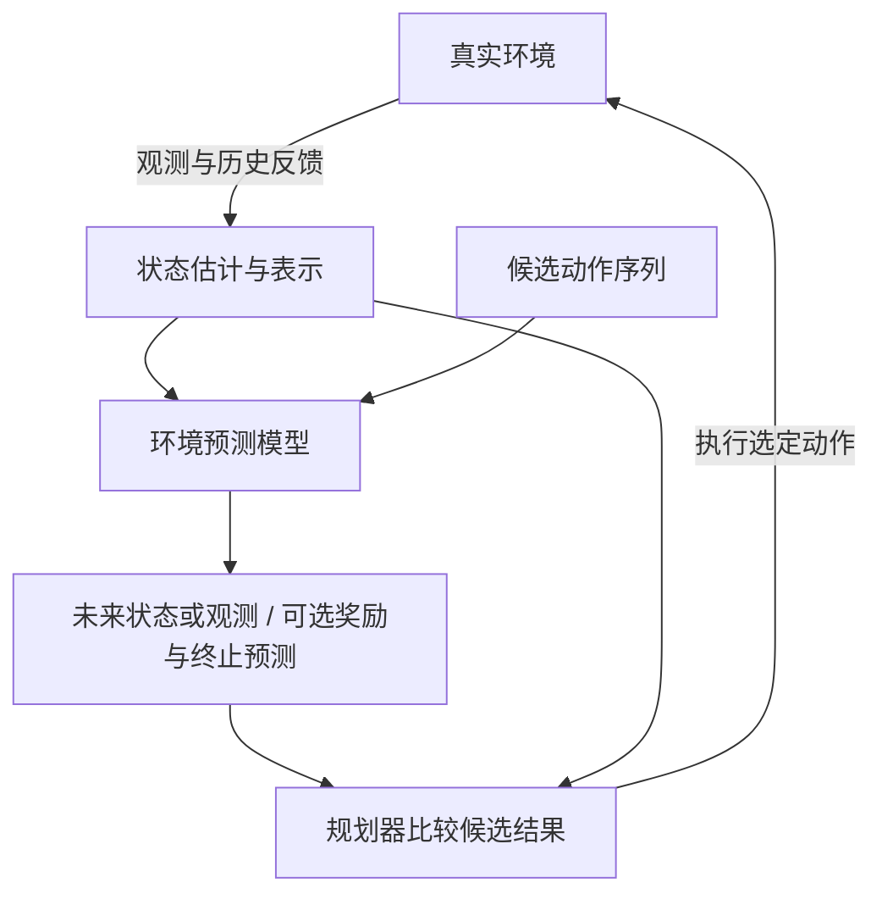

World Model（世界模型）表示环境状态及其演化规律，预测未来的观测、内部状态或任务相关结果。在控制和 Agent 场景中，它还需要刻画 action（动作）的影响，为规划或策略学习提供依据。不同研究对这个术语的使用范围不同：预测视频、学习潜在动力学、模拟交互环境和预测工具执行结果，都需要说明各自建模的对象与证据。

本页是 World Model 的系统学习与复习总入口，串联基础、架构、训练、推理、应用和资料阅读。全局定位见 [[architecture/|Architecture]]；视觉、音频和视频的表示入口见 [[architecture/multimodal/|Multimodal]]。多模态知识按环境需要接入，学习低维状态或文本工具环境可以直接从动力学与决策基础开始。

## Architecture Map

下面是一种利用世界模型在线规划的闭环，箭头区分模型内预测与真实环境执行：

动作条件化的潜在状态预测可以简写为：

$$
z_t = e_\phi(o_{\le t}, a_{<t}), \qquad \hat z_{t+1} \sim p_\theta(\cdot \mid z_t, a_t)
$$

其中 $o_t$ 是时刻 $t$ 的观测，$a_t$ 是当前动作，$e_\phi$ 用截至当前的观测及过去动作形成内部表示 $z_t$，$p_\theta$ 是参数为 $\theta$ 的动力学模型，$\hat z_{t+1}$ 是预测的下一内部状态。它是常见建模形式，既不保证 $z_t$ 完整恢复真实状态，也不要求所有世界模型都采用这套模块。

Rollout 指把模型预测向未来连续展开，imagination 指利用这些模拟轨迹评估行动或学习策略。另一种使用方式是在训练阶段用 imagined trajectories 训练 policy（策略），部署时直接由策略输出动作。因此，世界模型可以在训练时发挥作用，而无需在每次执行动作前在线规划。Reward（奖励）可以来自模型预测或外部规则；value（价值）估计未来累计回报，通常属于决策组件，不必与动力学模型合并。

## 与 Text LLM 和 Multimodal LLM 的关系

| 概念           | 主要能力                                             | 典型问题                                               |
| -------------- | ---------------------------------------------------- | ------------------------------------------------------ |
| Text LLM       | 建模文本序列和语言条件分布                           | 给定上下文，下一段文本可能是什么？                     |
| Multimodal LLM | 编码并融合多种 observation，输出可以是文本或其他模态 | 图像、视频、音频和文本共同表达了什么，或应该生成什么？ |
| World Model    | 表示环境并预测其演化；控制场景进一步刻画动作影响     | 接下来会发生什么？换一个动作会怎样？                   |

它们不是互斥的三级模型分类。一个 World Model 可以只使用低维 state；一个 Multimodal LLM 可以只做静态图像问答，也可以额外生成图像、音频或视频；一个 embodied system 则可能同时包含 multimodal encoder、latent dynamics、planner 和 policy。多模态输入输出描述接口范围，World Model 描述是否建模环境演化，两者不能互相替代。

## 需要持续区分的几个概念

### Observation 与 State

Observation（观测）是实际可见的输入，environment state（环境状态）描述系统演化所需的变量，latent state（潜在状态）则是模型学习到的表示。例如同一张球的位置照片可能对应不同速度，只凭单帧难以判断下一刻的位置。历史观测与动作有助于估计隐藏信息，但不保证完全消除不确定性。

### 多模态输入输出与 World Model

World Model 不要求必须接收或输出多种模态。低维状态、棋盘状态、工具轨迹或文本环境历史都可以作为建模对象；同样，一个系统即使能够输入图片并输出图片、音频或动作，也可能只是在做理解、生成、转换或策略执行。判断 World Model 时，应继续检查 state、时间演化、action consequence、rollout 和真实反馈。

### Video Prediction 与 World Model

被动视频预测也会学习环境演化，部分研究将其归入广义世界模型；动作条件化模型进一步预测某个行动之后的未来。画面质量、时间一致性、动作响应和控制收益是不同证据，不能互相替代。即使接收 action，模型也可能只学到行为数据中的相关性，仍需用环境交互验证行动后果。

### Prediction Model、Simulator 与 Planner

- **Prediction model**：给定历史或当前状态，以及可选 action，预测未来结果。
- **Simulator**：提供可以反复执行、重置和交互的环境接口，可能由真实引擎或 learned model 实现。
- **Planner**：比较候选 action 或 action sequence，选择下一步行动。

三者可以组合在同一个系统中，但职责不同。World Model 通常指 prediction / dynamics 这一层，不自动包含完整 simulator 或 planner。

Policy 直接选择动作。Vision-Language-Action（视觉—语言—动作，VLA）模型可以承担这一职责，即使没有显式预测未来环境状态。反过来，一个精确预测未来的模型，也需要决策目标或控制器才能选择行动。

## 核心问题

- observation 如何压缩成保留控制信息的 latent state；
- dynamics model 是否显式条件化于 action；
- 模型预测的是 pixel、feature、latent state 还是 reward；
- prediction model、simulator 和 planner 的边界如何划分；
- 长时域 rollout 中的误差如何累积，uncertainty 如何进入 action selection；
- prediction loss 的改善是否真的转化为 planning、control 和真实环境成功率的改善。

## 系统学习路线

### 1. 基础语言：环境与决策

1. [[fundamentals/dynamical-systems/|Dynamical Systems]]：理解 state、observation、transition 和 partial observability（部分可观测性），建立 Markov Decision Process（马尔可夫决策过程，MDP）及其部分可观测形式 POMDP 的语言。
2. [[fundamentals/control-and-planning/|Control and Planning]]：理解 policy、value、reward、model-based reinforcement learning（基于模型的强化学习）和 Model Predictive Control（模型预测控制，MPC）。
3. [[application/agents/planning|Planning]]：把控制理论中的 action selection 连接到 LLM Agent 的多步工具和环境交互。

这一阶段的复习问题是：环境的真实状态与模型可见信息有什么差别，预测未来与选择行动分别需要什么？

### 2. 输入与表示：从 observation 到 state

1. [[fundamentals/representation-learning/|Representation Learning]]：理解 feature、embedding 和 latent state 的区别。
2. [[architecture/multimodal/|Multimodal]]：理解 vision、audio、video encoder、projector 和 fusion。
3. 低维控制可以直接使用位置、速度等状态；文本工具环境可以使用历史动作和执行反馈；视觉任务需要处理遮挡、帧序列与时空对应。输入路线由环境决定。

这一阶段的复习问题是：模型保留了哪些预测和控制所需信息，又丢失了哪些细节？

### 3. World Model 架构：从状态预测到环境模型

1. observation encoder：把像素、视频、传感器或语言轨迹转换为可预测表示。
2. latent state：保留未来预测和控制所需的信息，而不是追求完整重建所有细节。
3. dynamics model：学习 $p(z_{t+1}\mid z_t,a_t)$ 或其确定性近似。
4. observation、reward、termination heads：按任务需要预测可见结果、奖励和交互是否结束；不是每个模型都需要重建像素。
5. planner / policy interface：将预测结果连接到规划或策略学习，区分环境模型和价值估计。

经典阅读可以分成三条支线，避免把不同机制串成单一路线：

| 支线                   | 阅读路标                                   | 重点追问                                                     |
| ---------------------- | ------------------------------------------ | ------------------------------------------------------------ |
| 潜在动力学与模型内学习 | World Models → PlaNet → Dreamer 系列       | 如何表示历史？学习到的动力学用于在线规划，还是用于训练策略？ |
| 任务相关预测与搜索     | MuZero                                     | 不重建完整观测时，奖励、价值和策略预测如何支持搜索？         |
| 预测式表示与生成式模型 | JEPA 类表示学习 → 视频生成与动作条件化预测 | 预测特征与预测像素有什么取舍？何时具备可检验的环境预测能力？ |

Joint-Embedding Predictive Architecture（联合嵌入预测架构，JEPA）是一类表示学习方法，不能仅凭名称认定某个实现已经具备动作条件化动力学。这些名称是按机制组织的阅读路标；具体结论需要相应原始资料和实验依据。

### 4. 训练：从轨迹学到环境模型

[[training/world-models/|World Model Training]] 串联轨迹、视频、动作和奖励数据，区分离线收集与在线交互、单步预测与多步一致性、观测重建与任务相关目标。[[training/data-engineering/|Data Engineering]] 承接数据清洗、分片和覆盖范围等基础问题。

这一阶段的复习问题是：模型见过哪些状态和动作，预测损失在哪些分布上被验证，策略改变后会不会进入模型不熟悉的区域？

### 5. 推理与决策：如何使用预测

[[inference/world-models/|World Model Inference]] 连接多步 rollout、候选动作比较、搜索、MPC 和计算预算。它还需要与 [[fundamentals/probability/calibration-uncertainty|Calibration and Uncertainty]] 一起讨论：不确定性如何影响行动选择，真实反馈如何修正状态估计。

这一阶段的复习问题是：模型被用于在线规划、离线策略训练还是数据生成？预测越远，误差和计算成本分别如何增加？

### 6. 应用与评测：预测是否真正有用

[[application/world-models/|World Model Applications]] 连接机器人、游戏和数字环境；[[application/embodied-agents/|Embodied Agents]] 关注感知与动作闭环；[[application/evaluation/|Evaluation]] 承接指标与对照设计。

评测至少分三层：单步和多步预测是否准确；在相同预算下，规划或策略是否获益；最终环境中的成功率、鲁棒性和交互样本效率是否改善。生成视频的视觉质量不能替代后两层，模型内获得高奖励也不能替代真实环境验证。

### 7. 前沿追踪：按研究问题组织

前沿阅读围绕问题持续更新，不依赖某个发布版本的短期排序：

| 研究方向             | 核心问题                                                                         | 关联知识层       |
| -------------------- | -------------------------------------------------------------------------------- | ---------------- |
| 通用环境模型与迁移   | 跨任务、场景和动作空间能否复用动力学，遇到新环境如何适配？                       | 训练、应用       |
| 可交互视频与空间建模 | 动作是否可控，物体与场景能否长期保持一致？三维空间加时间的 4D 表示是否支持交互？ | 多模态表示、推理 |
| 机器人与策略协同     | 世界模型如何辅助视觉—语言—动作策略，模拟收益能否迁移到真实执行？                 | 具身交互、训练   |
| 数字环境与语义预测   | 工具执行结果、信息缺口和长程任务状态如何预测并验证？                             | 规划、应用       |
| 不确定性与长期可靠性 | 分布变化、误差累积和模型被策略利用的问题如何被发现？                             | 推理、评测       |

这些方向可以重叠：robotics、game 和 software 描述环境领域；pixel、latent、3D 或 language summary 描述表示与预测目标；simulator、planner 和 policy 描述系统角色。用这三个维度定位资料，比把它们放进互斥分类更清楚。

## 重新学习时的三条入口

- **快速回顾**：本页 → [[fundamentals/dynamical-systems/|Dynamical Systems]] → [[fundamentals/control-and-planning/|Control and Planning]]。
- **系统学习**：动力学与控制基础 → 按需补充表示与多模态 → 本页架构和经典支线 → [[training/world-models/|训练]] → [[inference/world-models/|推理]] → [[application/world-models/|应用]]与[[application/evaluation/|评测]]。
- **Agent 研究**：[[application/agents/planning|Planning]] → [[sources/papers/2026-internalizing-the-future-world-model-agentic-training|Internalizing the Future]] → [[application/world-models/|World Model Applications]]，沿真实执行反馈检查语义预测的有效性。

阅读每篇 World Model 资料时，可以固定检查七个问题：

1. observation 和 state 分别是什么？
2. action 如何定义，模型是否显式接收 action？
3. 预测目标是 pixel、feature、latent state、reward 还是语言摘要？
4. 模型是 passive prediction 还是支持 intervention / counterfactual？
5. rollout 是连续预测而不接收新观测，还是会被真实环境反馈修正？
6. 评测的是 prediction quality、planning quality 还是最终 task success？
7. 长时域误差、uncertainty、latency 和计算成本如何处理？

## 资料与实践入口

- [[sources/papers/2026-internalizing-the-future-world-model-agentic-training|Internalizing the Future]]：已有的语义未来预测与 Agent 训练阅读笔记。它的任务和证据范围不能直接代表物理世界建模。
- [[sources/papers/2026-terminal-universe-turning-agent-trajectories-into-scalable-terminal-environments|Terminal-Universe]]：已有的轨迹到可执行数字环境构造笔记。环境构建为训练和评测提供条件，本身不等于学习到一个动力学模型。
- [[sources/|Sources]]：保存经典与前沿资料的来源、方法、证据和局限；研究名称与结果在相应资料页中核验。
- [[projects/|Projects]]：保存源码、实验和复现。实践可以依次选择低维动力学预测、模型内规划、像素环境学习和文本工具状态预测，并比较模型预测与真实执行。

专题机制由各层知识页维护，论文结论由资料页承接，实验结果由实践页承接；本页保留它们的学习顺序和入口，支持从同一个位置重新回顾整条路线。
