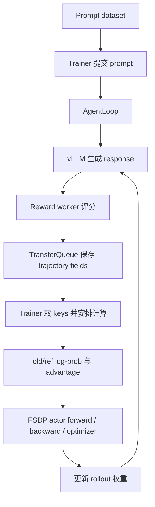

verl（Volcano Engine Reinforcement Learning for LLMs）是一套大模型强化学习后训练框架。它把模型生成、规则或模型奖励、优势计算、分布式优化以及权重同步组织为持续迭代的训练循环。

本项目通过一套固定运行学习源码：两台机器、每台四张 GPU，使用 FSDP 训练 Qwen3-4B、vLLM 生成回答，以同步 GRPO 优化数学问答。每轮 128 个 prompt、每题 4 次生成，得到的同一批 512 条 trajectory 会贯穿后续解释。具体配置和样本 P0 在 [[projects/verl-source-reading/01-sync-grpo-run-overview#贯穿全文的案例|01 的案例]] 中定义，完整阅读顺序集中在 [[projects/verl-source-reading/00-learning-guide|00 Learning Guide]]。

## verl 的主要应用场景

强化学习后训练中的回答是在训练时生成的。模型先回答问题或与工具环境交互，系统根据结果获得 reward，再更新模型，使下一轮更容易产生高分回答。verl 负责将生成和优化连接起来，也支持 PPO、GRPO、Agentic RL、OPD/MOPD 等不同路径。

它同时提供 SFT：使用固定的输入和目标答案训练模型。[[projects/verl-source-reading/verl-sft-training-path|SFT Training Path]] 将同一道数学题放入监督训练，对照说明 RL 为什么还需要 rollout、reward 和 advantage。

## 一批样本经过哪些部分

图中各框是职责，不能直接当作独立进程或独占 GPU。生成副本与训练 worker 在本例中共用 GPU，reference 模型负责 KL 参照，规则奖励不需要额外的 GPU 模型。

| 源码部分         | 在这轮训练里做什么                             | 进入点                                                           |
| ---------------- | ---------------------------------------------- | ---------------------------------------------------------------- |
| 配置与启动       | 组合配置，创建 V1 trainer 和服务               | `verl/trainer/main_ppo.py`                                       |
| Trainer          | 提交数据、等待生成、安排模型计算和同步         | `verl/trainer/ppo/v1/trainer_base.py`                            |
| AgentLoop        | 将一次生成或多轮交互组织为 output              | `verl/experimental/agent_loop/`                                  |
| 轨迹存储与采样   | 按 key 保存字段，通过 group 状态形成训练 batch | `verl/trainer/ppo/v1/agent_loop_tq.py`、`replay_buffer.py`       |
| Reward           | 解码回答、读取标准答案、计算得分               | `verl/experimental/reward_loop/`                                 |
| 算法与 loss      | 把 reward 和 log-prob 变成可优化目标           | `verl/trainer/ppo/core_algos.py`、`verl/workers/utils/losses.py` |
| Worker 与 engine | 将同一批数据分发到 rank，完成模型计算          | `verl/single_controller/`、`verl/workers/engine/`                |

## 正文章节

| 章节                                                                                                    | 核心内容                                                  |
| ------------------------------------------------------------------------------------------------------- | --------------------------------------------------------- |
| [[projects/verl-source-reading/01-sync-grpo-run-overview\|01 Sync GRPO Run Overview]]                   | 共同案例、整轮数据流、更新次数与参数状态                  |
| [[projects/verl-source-reading/02-config-and-hydra\|02 Launch and First Batch]]                         | Hydra、角色创建、dataset、collate、uid 和提交 prompt      |
| [[projects/verl-source-reading/03-data-protocol-and-batch-lifecycle\|03 From Prompts to Trajectories]]  | session、tokenization、生成请求、AgentLoopOutput          |
| [[projects/verl-source-reading/04-rollout-reward-and-agent-loop\|04 Reward and Training Batch]]         | 评分、rm_scores、TQ 写回、group 完成和采样重排            |
| [[projects/verl-source-reading/05-advantage-and-policy-loss\|05 Advantage and Policy Loss]]             | log-prob 对齐、GRPO 矩阵、PPO loss 到 logits 梯度、归一化 |
| [[projects/verl-source-reading/06-single-controller-and-ray\|06 Single Controller and Ray]]             | metadata 分发、worker 取数、两节点八卡执行                |
| [[projects/verl-source-reading/07-model-engine-and-backend\|07 Model Engine and Backend]]               | packed attention 隔离、FSDP 分片与更新、Megatron 对照     |
| [[projects/verl-source-reading/08-hybrid-engine-and-weight-sync\|08 Hybrid Engine and Weight Sync]]     | 训练分片到 vLLM 权重、缓存与显存切换、step 版本           |
| [[projects/verl-source-reading/09-ppo-and-grpo-codepath\|09 PPO and GRPO Codepath]]                     | 同一 trainer 的算法分支                                   |
| [[projects/verl-source-reading/10-async-trainer-and-off-policy\|10 Async Trainer and Off-policy]]       | 生成与训练重叠、policy version 与 staleness               |
| [[projects/verl-source-reading/11-agentic-rl-extension\|11 Agentic RL Extension]]                       | 多轮工具状态、observation mask、终止和评分                |
| [[projects/verl-source-reading/12-on-policy-distillation-and-mopd\|12 On-Policy Distillation and MOPD]] | 教师路由、逐 token 监督和 student loss                    |

实验命令与观察保存在 [[projects/verl-source-reading/labs/|Labs]]。正文中的短序列、rank 分配和 reward 矩阵用于解释机制；未标为运行结果的示例不代表已经执行过相应多机实验。

## 阅读基线

- Repository：[process-cxr/verl-upstream](https://github.com/process-cxr/verl-upstream)
- Revision：[`5b79827b04cee6e4b7b5ff737e047f1d72d50433`](https://github.com/process-cxr/verl-upstream/tree/5b79827b04cee6e4b7b5ff737e047f1d72d50433)
- Branch at reading start：`main`
- Reading start：2026-09-02
- 主实现：[`main_ppo.py → TaskRunnerV1 → ppo/v1`](https://github.com/process-cxr/verl-upstream/blob/5b79827b04cee6e4b7b5ff737e047f1d72d50433/verl/trainer/main_ppo.py#L102)

“默认”“支持”和具体字段均以这个快照为边界。旧 `main_ppo_v0.py` 仅在与历史教程对照时使用，不将两代代码混写成同一条调用链。源码链接固定 commit，方便直接核对文章中的语句。

通用算法和系统背景可查阅 [[training/post-training/grpo|GRPO]]、[[training/post-training/ppo|PPO]]、[[training/distributed-training/fsdp|FSDP]]、[[training/distributed-training/torch-distributed|torch.distributed]] 与 [[inference/serving-systems/vllm|vLLM]]；verl 特有的对象和执行路径保留在本项目中。
