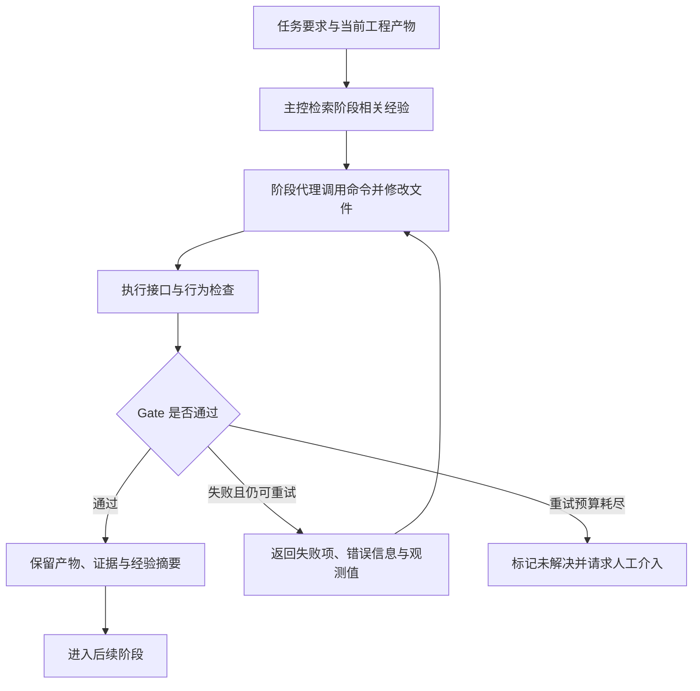

# HARBOR: A Harness Framework for Agentic Robot Reinforcement Learning

## 基本信息

- 标题：[HARBOR: A Harness Framework for Agentic Robot Reinforcement Learning](https://arxiv.org/abs/2606.08610)
- 作者：Zechu Li、Yufeng Jin、Xiaoyang Liu、Puze Liu、Vignesh Prasad、Carlo D’Eramo、Georgia Chalvatzaki
- 机构/来源：TU Darmstadt、Honda Research Institute Europe、Columbia University、Tongji University、Shanghai Research Institute for Intelligent Autonomous Systems、University of Würzburg、Hessian.AI
- 发表：arXiv:2606.08610v1
- 日期：2026-06
- 相关主题：[[application/agents/workflow-agent|Workflow Agent]]、[[application/agents/multi-agent|Multi-Agent]]、[[application/agents/memory|Agent Memory]]、[[application/embodied-agents/|Embodied Agents]]

## 研究问题：谁来完成机器人强化学习的工程闭环

机器人强化学习（Reinforcement Learning，RL）的困难不只在策略优化。一个新任务通常还要经历安装仿真器、导入机器人与物体、定义观测和动作、编写奖励、接入训练算法、检查行为、调整超参数，以及向真实机器人迁移等过程。

这些步骤相互依赖。动作接口写错，奖励和优化器即使正确，机器人也学不会；奖励上升，可能只是策略找到了与任务目标无关的高分行为；仿真成功，也可能因为接触、摩擦或控制延迟不匹配而无法部署。

HARBOR 研究的是：**能否让大语言模型（Large Language Model，LLM）代理承担这些相互耦合的工程工作，并用可执行证据决定流程是否可以继续？**

它的输入是仿真器代码库和任务要求，任务要求可以包含场景资产、成功标准、期望行为、算法和预算。输出则包括环境与奖励代码、训练配置、验证日志、策略 checkpoint、行为视频和调参记录。研究重点是把这些产物组织成可检查、可修复、可复用的流程（§1–3）。

### 两种 Agent、两种学习

论文同时讨论语言模型代理和机器人策略，必须区分两者的职责：

```text
工程层：LLM 代理
  阅读代码、修改环境、生成奖励、运行训练、分析曲线与视频
                              |
                              v
学习层：机器人策略
  接收观测 -> 输出控制动作 -> 与仿真环境交互 -> 通过 RL 更新参数
                              |
                              v
部署层：感知与控制系统 + 训练后的策略
  在真实机器人上执行动作
```

HARBOR 没有提出新的机器人策略优化算法，也没有展示通过这套流程更新 LLM 权重。它所说的 experience learning，是把试验中的有效做法与失败原因整理成外部经验，供后续代理检索。**训练机器人策略、积累工程经验和训练语言模型，是三件不同的事。**

## 方法基础：把 MDP 变成可检查的工程对象

机器人 RL 通常用 Markov Decision Process（MDP，马尔可夫决策过程）描述。论文采用：

$$
\mathcal{M}=(\mathcal{S},\mathcal{A},P,r,\rho_0,\gamma,T).
$$

其中，$\mathcal{S}$ 是状态空间，$\mathcal{A}$ 是动作空间，$P$ 是转移动力学，$r$ 是奖励函数，$\rho_0$ 是初始状态分布，$\gamma$ 是折扣因子；$T$ 在本文中表示终止条件。

这些数学对象在工程中有明确对应：

- 状态与观测：机器人关节、物体位置、目标状态等信息，以及它们的顺序、维度和单位。
- 动作：末端位姿增量或关节位置增量，以及它们如何经过控制器变成真实运动。
- 动力学：机器人资产、碰撞模型、质量、摩擦、仿真步长和控制频率。
- 奖励：距离、接触、抬升、稳定保持等项如何组合，是否真的鼓励目标行为。
- 初始化与终止：物体怎样放置，成功与失败何时触发，episode 如何重置。

MDP 给出了稳定接口，却没有自动提供正确实现。HARBOR 利用这些接口建立检查：先验证 `reset/step` 和动作语义，再检查奖励、训练和最终行为，尽量让底层错误在进入后续阶段前暴露（§2）。

## 系统结构：Agents、Commands、Artifacts、Gates 与 Knowledge

Harness 指包围模型的执行框架，包括指令、工具、运行环境、状态和反馈。它决定代理能看到什么、能做什么，以及怎样判断工作已经完成。

HARBOR 将机器人 RL 的 harness 表示为：

$$
\mathcal{H}_{\mathrm{RL}}=(\mathcal{H}_A,C,M,G,K).
$$

这里的 $M$ 表示工程产物，不是前面的 MDP $\mathcal{M}$。五个组成部分分别是：

- **Agents，$\mathcal{H}_A$**：处理有限阶段的代理。每个代理使用隔离上下文，读取当前阶段需要的文件与经验，将精简结果返回主控代理。
- **Commands，$C$**：标准化操作，如环境探测、运行训练、批量试验、行为渲染和奖励调优。操作既可单独调用，也可组成迭代流程。
- **Mutable Artifacts，$M$**：可持续修改的文件，包括任务定义、配置、代码、指标、视频和试验历史。文件承载工作流状态，也是代理之间的交接依据。
- **Verifiable Gates，$G$**：决定阶段能否通过的可执行检查，覆盖接口、数值和部分行为性质。
- **Reusable Knowledge，$K$**：模板、参考实现、脚本、预先提供的人工经验，以及运行后积累的经验摘要。

五者构成的闭环是：代理读取产物与知识，调用命令改变产物，通过 gate 验证变化，再把结果写回知识库。区别于把所有历史都塞进一段对话，后续工作可以从保存的文件和验证状态继续（Figure 1）。

### 文件是状态，而不只是最终交付物

一条奖励调优记录至少需要保留“改了什么、基于什么假设、采用哪个配置、得到什么行为、为什么继续或放弃”。仅保存当前最优奖励文件，会丢失已经试过的方向；仅保存完整聊天，又会让后续代理反复读取大量过程信息。

HARBOR 将代码、视频与日志留在试验目录，用任务历史、奖励历史和交接摘要承载跨阶段信息。持久文件保存细节，短摘要支持主控决策，二者共同承担长任务状态管理（§3、附录 C）。

## 执行流程：每个阶段怎样产生和验证结果

### 统一的阶段协议



Gate 的作用是把“代理认为完成”改成“满足已定义检查”。检查通过之后保留的是产物及其证据；它不自动意味着最终策略符合所有任务语义，也不意味着系统具有完整的形式化正确性保证。

### 依赖安装与基准探测

Dependency-generator 阅读代码库的依赖说明，生成安装计划与可复现的环境脚本；检查运行设备能否识别、环境是否建立、包能否导入。

Benchmark-generator 随后探测仿真后端和任务接口，整理已有任务、观测、动作与奖励实现，并生成随机动作 rollout 和视频渲染入口。Rollout 指策略或随机动作与环境交互形成的一段轨迹。

这里除了要求程序不报错，还要求随机轨迹奖励有限、视频有效、任务清单非空。否则，一个安装成功但渲染不可用的环境，会把问题拖到后续的行为诊断阶段才暴露（附录 C.1–C.2）。

### 任务生成

Task-generator 负责场景、任务注册、动作、观测、重置、目标与终止条件，并先留出占位奖励和域随机化接口。任务历史文件记录实现选择与验证结果。

这一阶段检查的不只是张量维度。例如，对末端位姿增量动作，系统要确认随机动作产生的目标位姿是否符合预期，以及控制器是否让机器人达到相应位姿。维度正确却把增量理解成绝对坐标，同样会破坏训练。

其他检查包括：重置值与实际仿真状态是否一致、目标是否进入观测、主动触发的终止条件是否生效，以及观测顺序和值是否正确。这些检查建立动作与环境的局部语义契约，但不能证明任意任务都已建模正确（§3、附录 C.3）。

### 奖励生成与修正

Reward-generator 可以从零生成奖励，也可以修改已有奖励，并检索相似任务的经验。产物包括奖励代码、各奖励项日志、修改历史和交接摘要。

验证分为两层：

1. **计算正确**：奖励不出现无穷或非数值；逐项记录的奖励按约定求和或相乘后，与环境返回的总奖励一致。
2. **行为有效**：运行诊断、短训练和视频检查，观察奖励是否带来目标行为；调优时再检验任务成功率是否达到要求。

三块立方体堆叠是典型案例。单一距离或接触奖励未必能形成完整顺序，分阶段奖励则可以在前一步完成后才激活后一步，例如先完成第一次堆叠，再堆第三块，最后要求稳定且与机器人脱离接触。**奖励数值上升和任务真正完成需要分别检查。**

本文这一做法得到预先提供的人工启发支持，不能全部归因于代理在没有先验帮助时自主发现了任务分解（§4.1、附录 C.4）。

### RL 算法接入与调参

接入阶段负责训练、评测、渲染入口和统一日志契约，支持：

- Proximal Policy Optimization（PPO，近端策略优化）。
- Soft Actor-Critic（SAC，软演员–评论家算法）。
- Twin Delayed Deep Deterministic Policy Gradient（TD3，双评论家延迟深度确定性策略梯度）。

验证要求训练能够执行、指标文件写出、曲线可生成，并确认行为视频真的有运动。论文特别使用帧差检查，避免“渲染进程正常退出，但没有输出有效运动画面”的情况。

调参代理先运行默认配置，再根据训练曲线、行为与已有经验调整归一化方法和算法超参数。每次试验保留配置、指标和视频，若连续若干轮没有超过当前最优结果，则停止搜索并输出收敛记录（附录 C.6–C.7）。

这里的调参对象是现有 RL 算法的实现和配置。论文没有提出替代 PPO、SAC 或 TD3 的新优化目标。

### 域随机化与仿真到真实迁移

Domain Randomization（DR，域随机化）通过改变质量、初始位姿、动力学参数或观测噪声等因素，使策略接触一组环境，而不是只适应单一仿真设置。

DR-generator 需要确认随机化实际生效：已知采样值应产生可预测的参数变化，重置后应正确重采样，观测噪声应与无噪声对照产生符合配置幅度的差异。例如，质量随机化不能只在配置文件里存在，却没有写入仿真器中的物体。

Sim-to-real 指将仿真中训练的策略迁移到真实机器人。本文还借助用户提供的真实轨迹进行系统辨识，使仿真物理参数接近真实运动；随机化范围也通过人工反馈调整。**仿真工作流自动化与真实部署完全自动化，在本文中不是同一个完成范围。**

## 并行调优与经验复用

### 主控保留判断，子代理隔离执行

论文采用 Centralized Control and Decentralized Execution（CCDE，集中控制与分散执行）：

1. 主控代理保留目标与调参历史，提出一组修改方向。
2. 子代理在独立试验目录和隔离上下文中运行不同候选方案。
3. 完整代码、视频与日志留在各自目录，主控接收结构化结果摘要。
4. 主控综合成功率、曲线和行为，选择后续方向。

隔离目录防止试验相互覆盖；隔离上下文降低一个代理反复读取其他试验全过程的负担；并行执行减少多次候选试验串行等待的时间。三者解决不同问题，不能把所有收益都叫作“多代理推理更强”（Figure 2）。

这里的异步是工程试验可以独立运行、完成后返回结果，不是语言模型异步 RL 训练中的采样策略滞后问题。

### 经验记忆记录什么

每轮结束后，主控将重复出现的模式整理成短条目，例如有效奖励项、不稳定参数区间和常见失败原因。后续按仿真器、任务或算法标签检索；阶段结束后将经验追加到跨运行记忆。

这种复用既可以利用运行中新发现的模式，也依赖既有模板、参考代码与人工经验。因此，“有经验”不是单一实验因素：去掉整个知识包，与只去掉先前运行产生的记忆，含义不同。

论文还把代理、命令与 gate 的定义写成可检查和修改的结构化自然语言。用户可以单独调用某一阶段、纠正产物，并从此前通过验证的状态恢复，而不必从头运行全部流程（§3）。

## 实验：工程自动化、策略质量与成本分别验证

### 实验范围与统计口径

整体评测覆盖六个基准、共 16 个任务，包括 IsaacLab、Bi-DexHands、ManiSkill、Genesis、MJLab 和 Loco-MuJoCo，涉及桌面操作、双手灵巧操作与移动控制。

其中两组主要实验的组织方式不同：

- **端到端实验**：四种操作任务分别在四个仿真器中实现，共 16 个“仿真器–任务”组合；这不是 16 种不同操作任务。
- **算法调参实验**：三个基准各选四个任务，共 12 个任务设置，分别考察 PPO、SAC 和 TD3。

论文说明仿真实验训练使用五个随机种子，每个种子用 4,096 次 rollout 评测，报告均值与标准误；真实机器人每个策略只评测十次。两类结果的统计精度不同（§4）。

### 端到端：能生成可学习的环境，但跨仿真器并不稳定

下表摘自 Table 2，全部为 HARBOR 的仿真成功率：

| 任务                            | IsaacLab | ManiSkill | Genesis |  MJLab |
| ------------------------------- | -------: | --------: | ------: | -----: |
| Stack-Cube，三块立方体堆叠      |    88.5% |     93.6% |   93.5% |  22.1% |
| Insert-Drawer，放入物体后关抽屉 |    93.9% |     64.8% |   78.1% |  12.2% |
| Lift-Box，双臂抬箱              |   100.0% |    100.0% |   94.4% | 100.0% |
| Dex-Grasp，灵巧手抓取           |    96.7% |     93.2% |   97.0% |   0.0% |

IsaacLab 的四个任务均达到 88.5% 以上，ManiSkill 和 Genesis 也能产生可学习的任务实现。MJLab 的差异则说明，统一工作流没有消除底层控制与物理模拟的困难。

作者根据日志将 MJLab 的失败主要归因于难以找到稳定控制所需的物理参数。这是作者的故障诊断，不是通过单独控制物理参数、排除其他因素后得到的因果结论（§4.1、附录 D.3）。

### 奖励设计：优势集中在长程顺序和行为诊断

IsaacLab 上的奖励基线对比固定了任务实现，包括观测、动作和重置逻辑，并使用相同的 Opus 主干模型、墙钟预算和任务说明。

| 任务          | HARBOR | Eureka | REvolve |
| ------------- | -----: | -----: | ------: |
| Stack-Cube    |  88.5% |   0.0% |    0.0% |
| Insert-Drawer |  93.9% |   0.0% |   36.3% |
| Lift-Box      | 100.0% |  99.7% |   93.2% |
| Dex-Grasp     |  96.7% |  93.5% |   95.5% |

短程、目标直接的 Lift-Box 和 Dex-Grasp 上，基线已经较强；差距主要出现在需要组合顺序和复杂接触的 Stack-Cube、Insert-Drawer。

作者给出的解释有两部分：行为反馈帮助发现抬升不足、与抽屉碰撞等失败；预先提供的人工启发帮助构造分阶段堆叠奖励。由于后者也是知识输入的差异，这个实验支持“包含先验知识和行为验证的完整系统更有效”，不能单独证明某一种代理组织方式优于其他方式。

在另一次堆叠奖励重设计中，利用前次经验后，时间从四小时降到 30 分钟，即约八倍加速。这是特定任务的经验复用案例，不是所有任务的平均加速比（§4.1）。

### 真实机器人：可迁移，但保留感知、辨识与人工反馈

真实平台包括双 Franka 机械臂，以及 xArm UF850 配 Allegro Hand。策略均以 20 Hz 输出动作：前者输出末端位姿增量，后者输出关节位置增量。

系统使用外部 RGB-D（Red-Green-Blue and Depth，彩色与深度）相机，结合 FoundationPose 与 SAM2.1 做目标分割和物体位姿跟踪，并对动作使用 Exponential Moving Average（EMA，指数移动平均）平滑。因而最终部署的是**感知、状态处理、学习策略与低层控制器组成的系统**，不能理解成 LLM 直接向机器人关节生成动作（附录 D.1）。

Table 2 的真实成功率如下；每个数值都来自十次试验：

| 任务          | IsaacLab 训练策略 | ManiSkill 训练策略 | Genesis 训练策略 | MJLab 训练策略 |
| ------------- | ----------------: | -----------------: | ---------------: | -------------: |
| Stack-Cube    |               50% |                60% |              60% |            10% |
| Insert-Drawer |               60% |                40% |              40% |             0% |
| Lift-Box      |               80% |                80% |              80% |            20% |
| Dex-Grasp     |               90% |                70% |              70% |             0% |

迁移确实可行，但损失明显。例如 MJLab 的 Lift-Box 仿真成功率为 100%，真实成功率仅 20%。这些数字展示了仿真成功与真实可靠性之间的距离；十次试验也不足以支撑对相近百分比的精细排序。

### 算法调参：学习曲线改善不等于所有最终分数都改善

调参实验以默认实现为起点，允许调整稳定化技巧和算法超参数。作者筛选的配置，训练时间最多为相应默认配置的两倍。这是有时间约束的搜索，不能解释成严格等算力或等总搜索成本比较（§4.2）。

附录 D.4 使用三个指标：

- **AUC，Area Under the Curve，学习曲线下面积**：在环境交互步数 $0$ 到 $N$ 上累计回报曲线，衡量整个训练过程的表现；更早学会通常会提高该指标。
- **$T_\tau$，达到回报阈值所需的环境步数**：越小表示越早达到该任务和算法对应的标准。
- **Final，最终回报**：采用截取训练曲线最后 10% 的平均回报，不是单次最佳分数。

阈值定义为：

$$
\tau=0.8\max_i R_i^{\mathrm{final}}.
$$

其中 $i$ 遍历同一任务–算法组合下默认配置和 HARBOR 的所有种子运行。各任务和算法分别计算阈值，不能跨任务直接比较原始 AUC 或 $T_\tau$。平均阈值到达速度改善只统计两种配置都能达到阈值的组合。

| 基准        | 作者汇总的平均 AUC 改善 | 作者汇总的 $T_\tau$ 降低 |
| ----------- | ----------------------: | -----------------------: |
| IsaacLab    |               约 1,300% |                    18.6% |
| Loco-MuJoCo |                    238% |                    60.4% |
| Bi-DexHands |                   12.3% |                    42.2% |

这些相对增益受默认配置强弱和奖励尺度影响。尤其 IsaacLab 的 Lift-Cube 默认 AUC 接近零且为负，转为正值后相对增益很大；约 1,300% 不能直接换算成固定倍数的样本效率提升。

正文概括为在 12 个任务设置中的 11 个匹配或超过默认配置，但 Table 4 进一步显示指标间存在取舍：

- ShadowHandBlockStack 的 PPO：AUC 从 493 提升到 555，Final 却从 716 降到 656。
- 同一任务的 TD3：AUC 从 190 提升到 199，Final 从 209 降到 181。
- ShadowHandDoorCloseIn 的 SAC：AUC 从 240 降到 236，达到阈值也更慢，但 Final 从 257 提升到 267。

因此，更准确的结果是：**HARBOR 经常能找到学习更快或总体曲线更好的配置，但不存在每个任务、每个算法、每项指标都同时改善的结论。**

## 消融：可靠性收益与成本数字应怎样理解

### 各变体真正移除了什么

消融使用干净的 ManiSkill 代码库，围绕 Push-Cube 流程比较五种配置。主表使用 Opus 4.7，默认并行数为四，每种配置重复十次（Table 3）：

- **完整 HARBOR**：保留隔离并行执行、gates 和知识包。
- **w/o CCDE**：同时移除子代理上下文隔离与并行试验，不能独立识别这两个因素各自的贡献。
- **w/o gate**：移除可执行验证。
- **w/o experience**：同时移除模板、参考资料与启发式知识，并非只删除此前运行产生的经验记忆。
- **Vanilla**：单一上下文代理，不使用上述三类机制。

### 主要结果

| 配置           | 阶段成功次数 | 阶段时间之和 / 分钟 | Ctx / 百万 tokens | 估算费用 / 美元 |
| -------------- | -----------: | ------------------: | ----------------: | --------------: |
| HARBOR         |        48/50 |                44.1 |             28.07 |           70.90 |
| w/o CCDE       |        46/50 |                83.4 |             65.30 |          130.68 |
| w/o gate       |      41/50\* |                32.9 |             23.97 |           79.70 |
| w/o experience |        32/50 |                53.5 |             44.39 |          120.27 |
| Vanilla        |        29/50 |              185.62 |             82.77 |          182.15 |

\* w/o gate 的 RL 接入阶段被标记存在静默渲染缺陷：进程正常退出，却没有渲染帧。因此其账面通过次数不能直接等同于经过完整验证的成功次数。

这里的 Ctx 是 context tax，即多轮过程中被反复读取的 cache-read tokens 数量。它可以累计到数千万，不表示单次请求的上下文窗口有数千万 tokens，也不是机器人 RL 的训练数据量。

分阶段观察比只看总表更有解释力：

- 完整系统的奖励生成与 RL 调参阶段分别成功 9/10；去掉 gates 后两者都降到 6/10。
- 去掉知识包后，奖励生成只成功 2/10，RL 调参为 4/10。
- 完整系统的奖励生成与调参时间之和为 $4.2+3.7=7.9$ 分钟；w/o CCDE 为 $24.0+25.5=49.5$ 分钟，约为前者的 6.3 倍。

这些结果支持局部上下文、可执行检查和先验知识对工程流程的重要性。但数值解释受以下统计与测量条件限制。

### 48/50 不是完整流程成功率

五个阶段各重复十次，合计得到 50 次阶段级观测。完整系统前三个阶段分别为 10/10，后两个阶段分别为 9/10，相加得到 48/50。

这不能写成“50 个独立任务成功了 48 个”，也不能直接推出从干净环境到最终策略的完整流程成功率为 96%。阶段相关性、失败是否来自同一次运行，以及如何恢复，都影响端到端结果；总表没有给出这类联合统计。

### 44.1 分钟与 70.90 美元不是完整机器人任务总成本

附录 D.5 说明，时间、Ctx 与费用来自五个独立阶段的 profiling 窗口之和，排除了空闲与编排时间。费用采用混合模型价格估算；缺乏并行的 w/o CCDE 和 Vanilla，在奖励与调参阶段的时间、cache-read 和费用还按四倍换算。

因此：

- 44.1 分钟是这些阶段统计窗口的合计，不是所有实验从安装到真实部署的耗时。
- 70.90 美元是代理使用的估算费用，不是包括机器人、仿真训练、搜索和部署在内的完整账单。
- 6.3 倍同时反映并行与上下文组织变化，并包含作者的串行倍率处理，不能当作隔离上下文本身带来的独立实测加速。

作者所称可靠性与成本上的 Pareto 最优，也只成立于这一个任务切片和已比较的配置集合。

### Sonnet 附录的证据口径仍不够清楚

附录 D.6 与 Table 5 给出了 Sonnet 4.6 的结果。不过，该段表述使用 “we consider repeating” 和 “we therefore lower S.R.”，其中 S.R. 指 Success Rate（成功率），并以约 0.32 倍费用、1.15 倍时间、1.3 倍 Ctx 描述数值变化，实测与推算的边界交代不足。

这部分可以记录为作者提供的补充比较，但不足以单独确证“换成较弱模型后仍获得相同可靠性”。主要的定量分析应以主表及其明确披露的条件为依据，而不是把两张表无差别合并为跨模型重复验证。

## 贡献与边界

HARBOR 的主要贡献是把机器人 RL 的工程依赖显式化：用文件保留任务状态，用阶段契约限制错误传播，用行为反馈连接代码与物理效果，再通过隔离试验和经验检索减少重复探索。论文表明，这种组织方式能在多种仿真器和任务中产出可训练的流程，并改善部分配置搜索的效率。

它同时保留了几个明确边界：

1. **验证范围取决于 gate 设计。** 接口、奖励有限性和视频运动都通过，仍可能没有覆盖真正的成功语义；代理也可能围绕不完善的验证标准优化。
2. **知识基础仍包含人工工程经验。** 对新仿真器、新控制方式或没有模板的任务，仍可能需要多轮修复，甚至失败。
3. **跨仿真器的稳定性尚未解决。** MJLab 结果说明，控制与物理参数难题不能仅靠流程编排消除。
4. **真实迁移仍依赖人工与外围系统。** 真实轨迹、随机化反馈、机器人接口、感知和控制处理，都是最终结果的一部分。
5. **消融没有完全分离因素。** 并行与上下文隔离一起移除，经验与模板一起移除，限制了对单项机制收益的归因。
6. **当前策略范围相对有限。** 作者将 Vision-Language-Action（VLA，视觉–语言–动作）策略和基于世界模型的策略列为后续扩展，不能把当前结果视作已验证了通用机器人基础模型训练。

这篇工作的启发在于：当工程流程能够产生清楚的中间状态和可执行反馈时，语言模型代理可以承担更多实验组织工作；它的可靠程度，仍由工具、知识、验证覆盖和底层环境共同决定。
