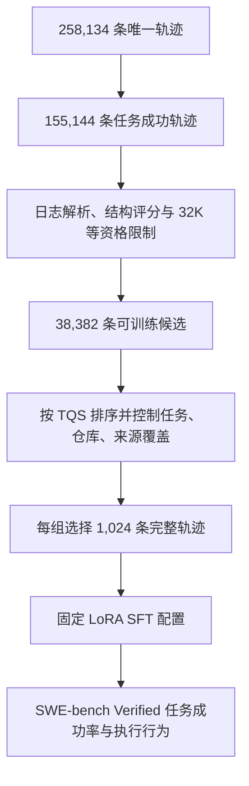

# Quality, Not Just Outcome: A Structural Scoring Framework for Selecting Coding-Agent Trajectories for Supervised Fine-Tuning

## 基本信息

- 标题：[Quality, Not Just Outcome: A Structural Scoring Framework for Selecting Coding-Agent Trajectories for Supervised Fine-Tuning](https://arxiv.org/abs/2610.13152)
- 作者：Sida Li、Yuanxin Liu、Shicheng Li、Linli Yao、Xu Sun、Haoli Bai、Xiao-Hui Li
- 机构/来源：Peking University、Huawei Technologies
- 发表：arXiv:2610.13152v1
- 日期：2026-10
- 代码/数据：[TQS](https://github.com/DuHeng0128/TQS)
- 相关主题：[[training/data-engineering/quality-filtering|Quality Filtering]]、[[training/data-engineering/synthetic-data|Synthetic Data]]、[[training/post-training/sft|SFT]]、[[application/agents/workflow-agent|Workflow Agent]]、[[application/evaluation/benchmark|Benchmark]]

## 研究问题：成功轨迹是否都值得模仿

Coding agent 的最终 patch 通过测试，只能说明它在当前测试集下完成了任务。同样成功的两条轨迹，可能有完全不同的过程：一条先定位、再修改、最后验证；另一条反复读取相同文件、重启命令、长时间试错后才得到正确 patch。有监督微调（Supervised Fine-Tuning，SFT）会模仿轨迹中的 reasoning 和 action，这些过程差异会进入训练信号。

论文提出 Trajectory Quality Score（TQS，轨迹质量分数），直接从事件日志中提取结构特征，对已经成功的轨迹进行第二层排序。它不需要大语言模型（Large Language Model，LLM）逐条评审，也不需要在评分时读取参考 patch 或执行最终测试。

TQS 的主假设是 **structured convergence（结构化收敛）**：较好的轨迹会逐步围绕修复目标组织证据、文件操作和工具行为。作者将它拆成信息聚焦、意图与动作对齐、策略动态三个维度，再加入异常模式检测。这里的“收敛”是行为启发式，不是优化理论中的收敛定理；评分器也不直接判断模型是否找到了真正的故障根因。

主实验在同一模型、同一训练配置和同一评测框架下比较筛选方法：TQS-Top 的任务解决率为 27.6%，高于随机筛选的 24.8%，但低于 GPT-4o 语义评审筛选的 28.4%。论文支持的是低成本结构筛选具有训练价值，语义评审仍然能够识别它遗漏的差异。

## 方法全貌与数据流



评分作用于整条轨迹。它不会生成新的 reasoning、修复错误步骤或把轨迹切成子任务。训练使用筛选后的完整交互序列，低秩适配（Low-Rank Adaptation，LoRA）参数挂在 attention projections 上，主模型参数保持冻结。

还需要区分两个阶段：

- **指标开发**：利用同一任务的一对成功/失败轨迹，筛掉方向错误、过度依赖长度或破坏多样性的候选指标。
- **正式筛选**：指标和手工权重固定后，仅从成功候选中按日志结构排序，不再用最终 patch 或评测分数给样本打分。

因此，“无需 outcome 进行评分”描述的是评分器运行时；整个指标设计并不是完全脱离成功/失败标签的无监督过程。

## 轨迹如何变成可计算的结构

第 3.1 节将轨迹定义为 $\tau=(s_0,\ldots,s_{n-1})$，每步包含：

$$
s_t=(a_t,m_t,o_t,F_t,\varepsilon_t).
$$

其中 $a_t$ 为动作类型，$m_t$ 为动作前的 thought，$o_t$ 为工具返回，$F_t$ 为该动作涉及的文件集合，$\varepsilon_t$ 为 observation 是否命中错误模式的标记。动作被归入七类：

```text
think | read_file | write_file | execute_bash | search | submit | other
```

附录 C 描述了 OpenHands 格式的解析方式：从 `messages/tool_calls` 恢复工具调用，将返回消息关联到对应步骤，从工具参数提取并规范化文件路径，用字符串和正则表达式检测 traceback、缺失文件、执行失败、测试失败等模式。

这一步决定了分数的含义。$F_t$ 是解析器发现的文件，不一定是程序实际读写的全部文件；$\varepsilon_t$ 是规则命中，也不等于完整的语义失败判定。迁移到另一套工具 schema 或把多条 shell 命令合并成一个 action 后，必须重新检查这些字段的可比性。

## 七项结构指标

七个分量都映射到 $[0,1]$，值越高代表越符合作者设定的过程偏好。它们分别提供局部证据，单个分量都不是正确性验证器。

### OEC：Observation Entropy Collapse，观测熵下降

对每个工具返回 $o_t$，计算字符频率的 Shannon entropy（香农熵）：

$$
H(o_t)=-\sum_c p_t(c)\log_2p_t(c).
$$

令 $\widetilde H_t$ 为三步滑动平均，$H_{\mathrm{open}}$ 为前 $\min(5,n)$ 个 observation 的平均字符熵，则：

$$
r_t=\frac{\widetilde H_t}{H_{\mathrm{open}}},
\qquad
s_{\mathrm{OEC}}=\operatorname{clamp}\left(1-\min_t r_t,0,1\right).
$$

作者用相对于早期 observation 的熵下降，近似表示证据范围开始聚焦。例如从杂乱的搜索输出转向局部文件和简短测试结果，可能出现这一特征。

但这里测的是**字符分布熵**，不是任务不确定性、知识增益或 reasoning entropy。低熵错误提示、重复日志或偶然出现的一段简单输出，也可能提高 OEC；而且公式取的是全程最低点，不要求熵持续下降。因此它需要与工具转移和异常模式共同使用，不能把字符熵下降直接解释为“模型理解得更深入”。

### PSN：Progressive Scope Narrowing，文件范围逐步收窄

先统计最近五步涉及的不同文件数：

$$
\mathrm{scope}_t=\left|\bigcup_{k=\max(0,t-4)}^tF_k\right|.
$$

然后在轨迹后半段，计算 scope 与步数之间的 Kendall 秩相关系数 $\tau_K$：

$$
s_{\mathrm{PSN}}=\operatorname{clamp}\left(\frac{1-\tau_K}{2},0,1\right).
$$

后半程文件范围越趋于下降，$\tau_K$ 越负，得分越高。它捕捉的是“搜索逐渐集中”的模式，而不是文件与 bug 的语义相关性。跨模块修复、集成测试或重新扩大排查范围可能是合理行为，不能仅凭 scope 扩大判为低质量。

### IAC：Intent–Action Consistency，意图与动作一致性

固定词典解析器从非 `think` 动作之前的 thought 中抽取粗粒度意图：阅读、编辑、执行/测试或搜索。把它映射到与实际动作可比较的类别后，在可抽取意图的步骤集合 $I$ 上计算：

$$
s_{\mathrm{IAC}}=\frac{1}{|I|}\sum_{t\in I}\mathbf{1}[\widehat a_t=a_t].
$$

“接下来读文件”之后发生读取，比“准备测试”之后又继续搜索更符合这一指标。但词典匹配只检查粗粒度行动类别，无法判断阅读的文件是否正确、测试是否相关、推理是否忠实。若 $I$ 为空，该指标未定义，不强制记零。

IAC 对缺失 reasoning、多语言 thought 和隐式计划尤其敏感。某个新数据源无法抽取意图时，首先要排查字段和解析器，而不能直接推断 agent 的规划能力差。

### TTE：Tool Transition Entropy，工具转移熵

统计相邻两步动作对 $(a_t,a_{t+1})$ 的经验频率 $p(i\to j)$，使用七类动作形成的 49 种转移计算：

$$
s_{\mathrm{TTE}}=
\frac{-\sum_{i,j}p(i\to j)\log_2p(i\to j)}{\log_2 49}.
$$

它是**相邻动作对的联合分布熵**，不等于条件熵 $H(A_{t+1}\mid A_t)$，也不等于模型 policy 的 token entropy。

长期重复同一种动作会得低分，适度变化通常得分更高。但无目的工具切换也可以提高转移熵；正常的连续多文件读取则可能较低。TTE 只能提供行为多样性的结构信号，需要结合聚焦程度和重复失败模式解释。

### SCP：Solution Commitment Point，首次修改时机

论文把 observation 未匹配错误模式的 `write_file` 计为 substantive edit（有效写入事件）。设首次此类编辑发生在 $t^*$，相对位置 $u=t^*/n$，则：

$$
d(u)=\max(0,0.2-u,u-0.5),\qquad \sigma=0.2,
$$

$$
s_{\mathrm{SCP}}=
\begin{cases}
0,&\text{没有有效写入事件};\\
\exp[-d(u)^2/(2\sigma^2)],&\text{其他情况}.
\end{cases}
$$

第一次修改位于轨迹 20%–50% 的区间时得满分，过早或过晚则平滑下降。这个区间是手工先验，不是由训练证明的通用最优编辑时间。

这里的 substantive 仅指工具没有报错，不保证 patch 有意义或已经接近正确修复。简单问题可能应当立即修改，复杂问题可能需要更久分析；相对步数也会受到日志粒度和终止时机影响。

### PED：Post-Error Diversity，错误后的行为变化

对后面还有动作的错误步骤集合 $\mathcal E_\tau$，组合动作类别变化和文件集合的 Jaccard distance（杰卡德距离）：

$$
J(F_{t+1},F_t)=1-
\frac{|F_{t+1}\cap F_t|}{|F_{t+1}\cup F_t|},
$$

$$
d_t=\frac12\left(\mathbf{1}[a_{t+1}\ne a_t]+J(F_{t+1},F_t)\right),
\qquad
s_{\mathrm{PED}}=\frac{1}{|\mathcal E_\tau|}\sum_{t\in\mathcal E_\tau}d_t.
$$

同一种动作、同一批文件上的重复失败得分低，改变工具或文件范围得分更高。没有可用错误转移时，PED 未定义。

行为变化不等于错误恢复成功。修正同一命令的参数后重试，可能是正确决策却得不到高分；换到无关文件也可能提高 PED。它描述的是反应模式，未验证“诊断—修正—成功”的完整因果链。实现还需明确空文件集合时的 Jaccard 约定。

### DPI：Dirty Pattern Indicator，异常过程模式

检测过早终止、没有编辑、重复 shell 命令循环和重复错误。设重复循环比例为 $l_p$，错误重复率为 $e_r$：

$$
p=0.4\mathbf{1}[\mathrm{early}]
+0.4\mathbf{1}[\mathrm{no\ edit}]
+\min(0.3,3l_p)+\min(0.3,0.6e_r),
$$

$$
s_{\mathrm{DPI}}=1-\min(1,p).
$$

没有触发异常模式时得满分。DPI 在聚合中只占 0.10，属于软惩罚；它不是检测到循环就自动拒绝样本的硬规则。论文给出了惩罚形式，但复现仍需核对 early-stop、循环等具体检测条件。

## 总分、缺失分量与权重

作者固定使用以下手工权重，没有用下游任务解决率调参：

| 维度 | 分量 | 权重 |
|---|---|---:|
| 信息聚焦 | OEC | 0.30 |
| 信息聚焦 | PSN | 0.10 |
| 意图—动作对齐 | IAC | 0.25 |
| 策略动态 | TTE | 0.10 |
| 策略动态 | SCP | 0.05 |
| 策略动态 | PED | 0.10 |
| 异常模式 | DPI | 0.10 |

对轨迹 $\tau$ 上已定义的分量集合 $C^*(\tau)$，只对这些分量重新归一化：

$$
\mathrm{TQS}(\tau)=
\frac{\sum_{c\in C^*(\tau)}w_cs_c(\tau)}
{\sum_{c\in C^*(\tau)}w_c}.
$$

例如，没有出现错误时不需要构造一个“错误恢复能力 = 0”的标签，直接移除 PED 并重分配其余有效权重。步数少于 3，或有效分量不足 4/7 的轨迹被排除。附录 D 的最终候选池里，六个分量均有定义，PED 仅有 0.7% 未定义。

这种处理也意味着，不同缺失模式下的 TQS 实际依据不同证据。若另一批数据大量缺失 thought，IAC 可能被整项移除，分数即使相近也不再代表同样的质量构成。因此跨数据源排序应同时保存分量分数、覆盖率与缺失原因。

附录 I 单独扰动 OEC、IAC 和 DPI 权重，Top-1,024 集合与主设定的重叠率为 93.1%–99.6%。这说明当前候选池附近的选择较稳定，但不是权重全局最优或下游性能对权重不敏感的证明。

## 指标如何经过筛选与验证

### 成功/失败配对与长度相关性

第 3.4 节对同一任务的成功轨迹和失败轨迹配对。候选指标需要满足：

- concordance（一致率）大于 0.5，即更常给成功轨迹较高分；
- 与轨迹步数的 Spearman 秩相关绝对值小于 0.25；
- 筛选后仍保留合理的行为多样性。

TQS 的配对一致率为 0.732，与步数的相关系数绝对值为 0.092。单项 OEC、IAC、PSN 的一致率分别为 0.640、0.612、0.585，整体分数优于这些单项。

一个有启发性的反例是 Hypothesis–Commit Ratio（HCR，探索与执行分配比例）。它偏好轨迹早、中、晚三段的探索/执行比依次下降。虽然通过了前两个数值门槛，加入后 Top-1K 有 99.9% 集中在同一个二值行为模式，因此被排除（附录 E）。一个指标能区分部分成功/失败样本，并不保证它筛出的数据有足够行为覆盖。

### 成功轨迹内部的人类与模型评审

作者从至少有三条成功运行的 300 个任务中，各取高、中、低 TQS 轨迹，组成 900 对比较。五名软件工程学生分担标注，每对由一名学生判断；另由 Claude Sonnet-5 进行独立模型评审。评审看不到 TQS，每对还交换展示顺序，以检查位置偏好。

表 4 与附录 B 报告：

| 统计 | 人工评审 | Sonnet-5 |
|---|---:|---:|
| 高分 vs. 低分的排序一致率 | 85.2% | 81.1% |
| 排除展示顺序不一致后的总体一致率 | 78.7% | 75.4% |
| 单条 rubric 评分的 pooled concordance | 73.3% | 76.2% |
| 完整高 > 中 > 低排序匹配率 | 45.7% | 41.3% |
| 与质量排序的 Spearman $\rho$ | 0.417 | 0.402 |

总体一致率使用 724 对比较，其余 176 对被当作顺序不一致的 ties；不能把 78.7% 理解成对所有 900 对或全部轨迹都达到该准确率。完整三项排序的随机匹配率为 1/6。人工判断虽独立于 TQS，但每对只有一名学生，不构成多标注者一致性验证。

语义评审会捕捉一些结构指标遗漏的信息。附录 B 举例：低 TQS 轨迹可能找到真正根因并做最小修复，而高 TQS 轨迹只解决次级症状；同样的一行 patch，有的轨迹做了复现和边界测试，有的只做静态检查。测试通过和结构干净，都不足以确认根因分析、最小修改和验证充分性。

### 两项容易高估的辅助验证

Figure 2 在 413,278 条已发布评分记录上按 TQS 分十分位，resolved rate 从最低组 54.1% 升至最高组 86.9%。但这些记录包含 source shards 和 reward-1 convenience shards，不能把它们当作 413,278 条相互独立的唯一轨迹，也不能将该相关性解释成成功轨迹内部训练价值的直接测量。

附录 G 进一步报告，在 25–40 steps 的长度区间内，TQS 区分 Top/Bottom 的 pair-AUC 为 1.000。这里的 AUC 是 Area Under the Curve（曲线下面积），表示高分组和低分组的两两排序能力。但 Top/Bottom 本来就按 TQS 定义，复合分数完美区分两组基本来自分组方式。这项检查说明分数组间差异仍存在于相近长度区间，不能独立证明质量有效性。更有说服力的证据是成功轨迹盲评和下游训练对照。

## 数据、训练与实验控制

### 三个数据规模分别代表什么

CoderForge-Preview 包含 258,134 条唯一 OpenHands 轨迹，覆盖 51,201 个任务，由 Qwen3-Coder-480B teacher 生成。任务来自 SWE-Smith、SWE-Rebench 和 R2E-Gym。

其中 155,144 条 passing trajectories 是评分和选择的成功候选。固定预算 SFT 进一步要求轨迹至少 3 步、分量覆盖率至少 4/7、tokenized length 不超过 32,768，结合 ID 去重后留下 38,382 条。32K 上限用于让样本加上 chat template 后容纳在 40,960-token 训练窗口内。附录 H 说明，所有 passing trajectories 都满足步数和覆盖条件，主要缩减来自长度上限及去重。

| 来源 | 成功轨迹 | SFT 候选 | 保留率 |
|---|---:|---:|---:|
| SWE-Smith | 89,501 | 23,569 | 26.3% |
| SWE-Rebench | 44,739 | 7,821 | 17.5% |
| R2E-Gym | 20,904 | 6,992 | 33.4% |
| 合计 | 155,144 | 38,382 | 24.7% |

**155,144 条不等于全部参加了训练，38,382 条也不是训练集大小。** 每种筛选条件最终只选择 1,024 条完整轨迹。实验并未验证被排除的约四分之三成功轨迹是否低质量，尤其不能由此推出长于 32K 的轨迹没有学习价值。

### 排序与多样性控制

Top-K 和 Bottom-K 首先按分数排序，再分阶段贪心填充：先尽量每个任务一条，再优先增加未覆盖仓库，最后按分数补足，同时设置每任务最多 30 条。所有选择还匹配候选池的来源比例；Random-K 在来源分层内均匀抽样（附录 C.1）。

| 统计 | Top-K | Bottom-K | Random-K |
|---|---:|---:|---:|
| 轨迹数 | 1,024 | 1,024 | 1,024 |
| 平均 TQS | 0.714 | 0.454 | 0.589 |
| 平均步数 | 34.2 | 53.0 | 41.0 |
| 平均 tokens | 28.1K | 26.3K | 26.9K |
| 任务数 / 仓库数 | 847 / 209 | 847 / 204 | 825 / 217 |
| 单任务最大轨迹数 | 30 | 30 | 59 |
| Dirty flag 比例 | 1.0% | 64.3% | 13.6% |

Top-K 步数更少，但 token 数反而更高，说明步数和文本长度不能混为一谈。论文控制了来源和覆盖，却没有让所有集合在任务身份、仓库身份及重复度上完全一致；Random 的单任务最大数量为 59，也没有采用相同的 30 条硬上限（表 2）。这仍可能给纯质量归因留下混杂因素。

固定 1,024 条也不等于严格固定训练 tokens，更不等于固定参与监督损失的 assistant tokens。Top-LM-K 的长度匹配缓解了其中一项差异，但要区分数据效率与计算效率，仍需同时记录输入 tokens、被监督 tokens 和训练计算量。

### 学生模型和 loss mask

学生为 **Qwen3-Coder-30B-A3B-Instruct**，采用 LoRA，只在 assistant 和 tool-call 段计算监督损失，user 消息和 tool observations 被 mask 掉。输入中仍保留工具返回，供模型条件化生成，但模型不被训练去复现这些 observation。

评测采用软件工程任务基准 SWE-bench Verified，使用 OpenHands v0.52.1，与轨迹生成的 scaffold/version 对齐。指标 pass@1 在此表示单次运行解决任务的比例。

主表中 “Base, no SFT” 指该 Instruct checkpoint 没有进行本次额外轨迹 SFT，不是未经后训练的 pretrained base。论文声称各组超参数一致，但 PDF 及附录 C 未列出学习率、LoRA rank、训练轮数、batch size 等完整数值，精确复现还需核对公开实现配置。

## 下游结果与消融

### 成功轨迹的训练价值存在明显差异

表 3 的主结果如下，各筛选组均使用 1,024 条轨迹：

| 选择方法 | Easy | Medium | Hard | Overall |
|---|---:|---:|---:|---:|
| 原始 Instruct，无本次 SFT | 36.6 | 19.2 | 2.2 | 24.4 |
| Random-K | 40.7 | 16.9 | 2.2 | 24.8 |
| Bottom-K | 33.5 | 16.9 | 0.0 | 21.8 |
| Shortest-K，仅按 token 长度 | 37.6 | 18.4 | 0.0 | 24.2 |
| DPI-only-K | 37.6 | 19.9 | 2.2 | 25.2 |
| GPT-4o rubric judge | 43.3 | 21.1 | 6.7 | **28.4** |
| Top-LM-K，与 Random 长度匹配 | 40.7 | 20.7 | 4.4 | 27.0 |
| TQS Top-K | 42.3 | 20.3 | 6.7 | **27.6** |

TQS-Top 相比 Random 高 2.8 个百分点，相比未追加 SFT 的起点高 3.2 个百分点。Bottom-K 相比起点低 2.6 个百分点：最终成功并不保证模仿整个执行过程能提升学生。

Shortest-K 的 24.2% 说明只挑短样本不足以获得收益。长度匹配的 Top-LM-K 仍达到 27.0%，保留了大部分收益，支持 TQS 并非单纯利用 token 长度。但由于任务与仓库并未逐一完全配对，该对照仍不是所有混杂因素都消除的实验。

GPT-4o judge 的整体分数最高，TQS 并未超过它。相对 Random 的提升，TQS 得到 2.8 个百分点，语义 judge 得到 3.6 个百分点，前者约保留后者 78% 的增益；二者在 Hard 上同为 6.7%。论文的取舍是大幅降低选择成本，同时保留大部分观测收益。

### 维度消融

删除一个维度后重新筛选数据并训练，表 5 得到：

| 选择信号 | Overall pass@1 |
|---|---:|
| 完整 TQS | 27.6 |
| 移除信息聚焦 | 24.6 |
| 移除意图—动作对齐 | 23.0 |
| 移除策略动态 | 25.8 |

移除 IAC 所在的意图—动作维度下降最大。这支持当前配置下这些维度组合有用，但还不能推出“更多可见 reasoning 必然改善训练”：IAC 是固定词典的粗粒度匹配，消融改变的是整个选样集合，仍可能同时改变任务覆盖和其他样本属性。

### 模型的执行行为有没有变化

作者在各微调模型自己的评测 rollout 上重新计算过程指标（表 6）：

| 指标 | Top 模型 | Random 模型 | Bottom 模型 |
|---|---:|---:|---:|
| 平均 steps | 50.66 | 57.64 | 63.46 |
| OEC | 0.571 | 0.521 | 0.484 |
| PSN | 0.570 | 0.548 | 0.568 |
| SCP | 0.777 | 0.798 | 0.772 |
| PED | 0.192 | 0.267 | 0.164 |
| DPI | 0.931 | 0.923 | 0.906 |

Top 模型步骤更少，观测聚焦与异常模式指标更好。但 SCP、PED 都没有超过 Random，PSN 也只略高于 Bottom。学生没有简单复制训练数据的全部分数轮廓，过程变化与成功率之间仍需分别评价。

## 计算成本与工程落点

附录 C 在 AMD EPYC 7413 上用 3,462 条轨迹测量实现性能，中位长度为 53 steps：

- 单 worker 耗时 149.2 秒，约每条 43 毫秒、每秒 23.2 条；
- 四个 workers 达到每秒 87.5 条；
- 由此外推 258,134 条唯一轨迹约需单核 3.1 小时，或四 worker 墙钟时间约 49 分钟；
- 按代表性四核云实例价格估算，完整评分约 0.1–0.2 美元。

GPT-4o baseline 按每条约 28K 输入 tokens、200 输出 tokens，以及每百万输入/输出 tokens 2.50/10 美元估价：38,382 条候选约 2,750 美元，258,134 条约 18,600 美元（附录 F）。这是给定上下文长度和单价的费用估算，不是完整批量服务实测账单；全库长尾也可能改变平均长度。

论文称各分量具有随步数线性增长的 CPU 开销。实际实现还必须读取 observation 字符、解析路径，并计算 Kendall 秩相关；后者的复杂度取决于实现。因此，大规模成本应按日志字节数、token 长度、步数和实现吞吐共同测量，不宜仅把每条 43 毫秒外推到任意 200K 轨迹。该实测中正则错误检测占 58% 时间，字符熵占 13%，也说明文本扫描仍是重要成本。

TQS 的部署产物是每条轨迹的结构分数、分量覆盖信息和被选训练子集。它没有增加学生推理时的模块；推理时不需要再调用 TQS，除非另行把它用于行为诊断。

## 对轨迹数据处理的适用范围

TQS 提供了一种可以接在 outcome verification 之后的过程质量排序：先确认最终产物通过当前验证，再检查是否值得模仿整段交互。结构评分、任务来源和语义正确性是不同维度，应分别保留。

对包含 reasoning 的长轨迹，可直接借鉴的是：从原始事件恢复动作、observation、文件与错误标记，保存结构分量，而不是先把整条轨迹压平成文本再判断。对缺失 thought 的记录，则需要单独统计 IAC 可用率和重归一化情况，避免把解析缺失混成质量差异。

不过，这篇验证的是 assistant/tool-call loss masking 下的少量 LoRA SFT。它没有验证所有 tokens 都参与下一个 token 预测（Next-Token Prediction，NTP）的 mid-training，也没有研究百 B 级数据 mixture 或 200K 轨迹。将其用于更大规模训练时，能够继承的是候选质量信号与对照实验设计，不能直接继承固定权重、32K 长度阈值或下游增益。

## 局限与研究判断

**证据范围较窄。** 单一 teacher、OpenHands scaffold、一个 30B-A3B 学生和一个主要下游基准构成了当前训练证据。7B 初步实验没有显示稳定的筛选差异，更大模型、全参数训练和跨 scaffold 迁移仍未验证。

**缺少多随机种子与增益不确定性。** 每组只训练一次，未给出下游差值的多种子方差或成对显著性分析。27.6 对 24.8 的方向值得重视，但 27.6 对 28.4 的小差异不能直接认作稳定的方法排名；Hard 组的百分比变化也可能对应很少任务。

**完整轨迹覆盖被长度预算大幅限制。** 只有 24.7% 成功轨迹进入候选池。长轨迹中的恢复、重定位和多轮验证可能有价值，论文没有对该长尾给出负面结论。训练污染也需单独控制：正文描述了候选池内部的任务/仓库覆盖，却未明确展开与 SWE-bench Verified 的任务级、仓库级重叠排查协议。

**分数包含明确的行为先验。** 早期编辑、文件范围扩大、同工具重试或低工具多样性，都可能是合理策略。OEC、IAC、SCP、PED 只能近似某些过程属性，在不同任务难度、语言、日志粒度下需要重新校准。

**结构筛选具有价值，语义正确性仍需其他证据。** 论文最有说服力的部分，是在成功轨迹内进一步筛选后，固定学生与训练流程获得了更好的任务结果；长度匹配对照和盲评提供了补充支持。最需要避免的扩张，是把 TQS 当作通用的 agent 能力分数、语义 verifier，或直接作为强化学习奖励。当前证据支持它作为低成本数据筛选与诊断工具，尚未证明优化这个分数本身就能持续提升任务能力。

## 参考资料

- [Quality, Not Just Outcome, arXiv:2610.13152v1](https://arxiv.org/abs/2610.13152v1)
- [TQS 项目仓库](https://github.com/DuHeng0128/TQS)
- [[training/data-engineering/quality-filtering|Quality Filtering]]
- [[training/post-training/sft|SFT]]
